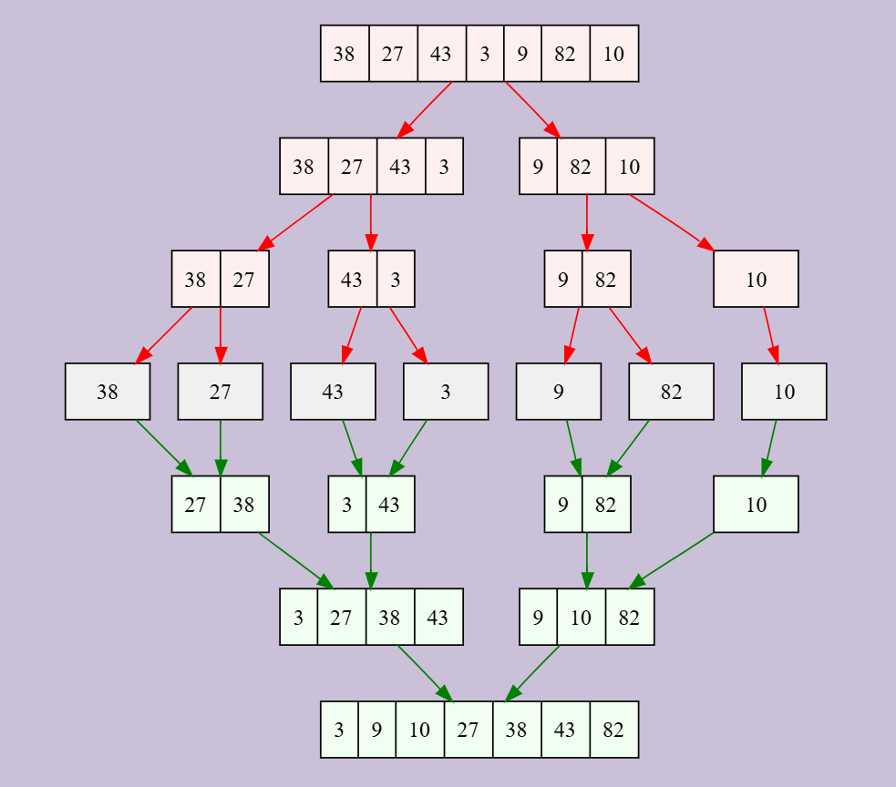
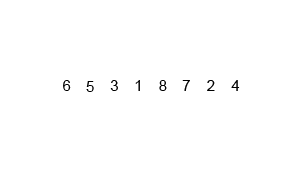

[](https://classroom.github.com/a/yasidRp_)
# W10_4


[Merge sort](https://en.wikipedia.org/wiki/Merge_sort) is a divine-and-conquer sorting algorithm that splits an array into smaller subarrays, recursively sorts them, and then merges them back to gether in sorted order. It is very efficient sorting algorithm in terms of time and space complexity. It is also stable. One down side is that it is not sorting in-place, which means that it requires additional memory for merging.



The merge sort pseudocode example below describes important aspects on how to implement it.
````
function merge(left, right):
    result = empty array
    while left and right are not empty:
        if left[0] ≤ right[0]:  # Change to ≥ for descending order
            append left[0] to result
            remove left[0] from left
        else:
            append right[0] to result
            remove right[0] from right
    append remaining elements of left and right to result
    return result

function mergeSort(array):
    if size of array ≤ 1:
        return array
    mid = size of array // 2
    left = mergeSort(array[0:mid])
    right = mergeSort(array[mid:])
    return merge(left, right)
````
Expected interface for the algorithm:
````
def merge(PLeft: list[int], PRight: list[int], PMerge: list[int], PAsc: bool = True) -> None:
    return None

def mergeSort(PValues: list[int], PAsc: bool = True) -> None:
    # Sort PValues.
    # PAsc: in ascending order by default. False will sort in descending order.
    return None
````
Commands:
````
# Tab 1 - Insert dataset name 'A10_D10.txt' manually
python A10_T4.py 
# Tab 2 - CLI Argument (sys.argv[1])
python A10_T4.py A10_D10.txt
# Tab 3 - CLI Argument (sys.argv[1])
python A10_T4.py A10_D100.txt
````
Example program runs:

Run 1
````
Program starting.
Insert filename: A10_D10.txt
Raw 'A10_D10.txt' -> 1000, 221, 392, 621, 47, 448, 163, 120, 197, 781
Ascending 'A10_D10.txt' -> 47, 120, 163, 197, 221, 392, 448, 621, 781, 1000
Descending 'A10_D10.txt' -> 1000, 781, 621, 448, 392, 221, 197, 163, 120, 47
````

Run 2
````
Program starting.
The filename 'A10_D10.txt' was passed via CLI.
Raw 'A10_D10.txt' -> 1000, 221, 392, 621, 47, 448, 163, 120, 197, 781
Ascending 'A10_D10.txt' -> 47, 120, 163, 197, 221, 392, 448, 621, 781, 1000
Descending 'A10_D10.txt' -> 1000, 781, 621, 448, 392, 221, 197, 163, 120, 47
````

Run 3
````
Program starting.
The filename 'A10_D100.txt' was passed via CLI.
Raw 'A10_D100.txt' -> 98, 879, 187, 715, 385, 217, 526, 645, 364, 450, 809, 546, 307, 113, 699, 935, 995, 993, 542, 984, 46, 360, 492, 40, 365, 380, 69, 933, 762, 980, 680, 969, 76, 522, 534, 766, 984, 246, 295, 604, 435, 405, 412, 782, 810, 259, 958, 245, 364, 601, 711, 372, 170, 257, 329, 812, 237, 826, 733, 493, 164, 153, 76, 411, 106, 820, 354, 38, 139, 757, 792, 727, 583, 345, 550, 325, 64, 315, 232, 531, 918, 346, 999, 854, 732, 452, 816, 797, 28, 522, 46, 880, 612, 898, 330, 382, 358, 952, 796, 207
Ascending 'A10_D100.txt' -> 28, 38, 40, 46, 46, 64, 69, 76, 76, 98, 106, 113, 139, 153, 164, 170, 187, 207, 217, 232, 237, 245, 246, 257, 259, 295, 307, 315, 325, 329, 330, 345, 346, 354, 358, 360, 364, 364, 365, 372, 380, 382, 385, 405, 411, 412, 435, 450, 452, 492, 493, 522, 522, 526, 531, 534, 542, 546, 550, 583, 601, 604, 612, 645, 680, 699, 711, 715, 727, 732, 733, 757, 762, 766, 782, 792, 796, 797, 809, 810, 812, 816, 820, 826, 854, 879, 880, 898, 918, 933, 935, 952, 958, 969, 980, 984, 984, 993, 995, 999
Descending 'A10_D100.txt' -> 999, 995, 993, 984, 984, 980, 969, 958, 952, 935, 933, 918, 898, 880, 879, 854, 826, 820, 816, 812, 810, 809, 797, 796, 792, 782, 766, 762, 757, 733, 732, 727, 715, 711, 699, 680, 645, 612, 604, 601, 583, 550, 546, 542, 534, 531, 526, 522, 522, 493, 492, 452, 450, 435, 412, 411, 405, 385, 382, 380, 372, 365, 364, 364, 360, 358, 354, 346, 345, 330, 329, 325, 315, 307, 295, 259, 257, 246, 245, 237, 232, 217, 207, 187, 170, 164, 153, 139, 113, 106, 98, 76, 76, 69, 64, 46, 46, 40, 38, 28
````
